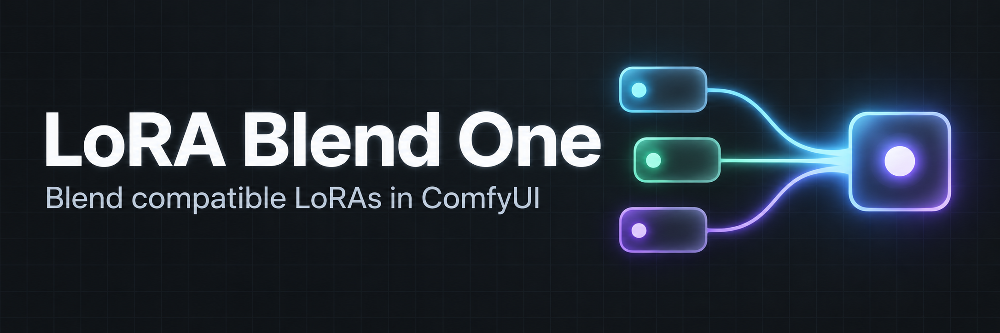
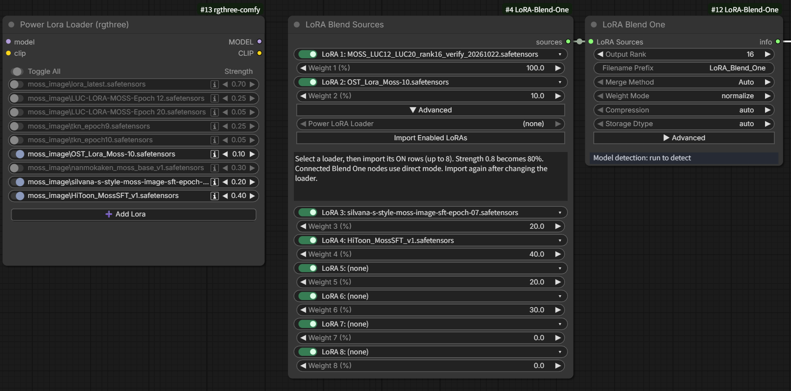
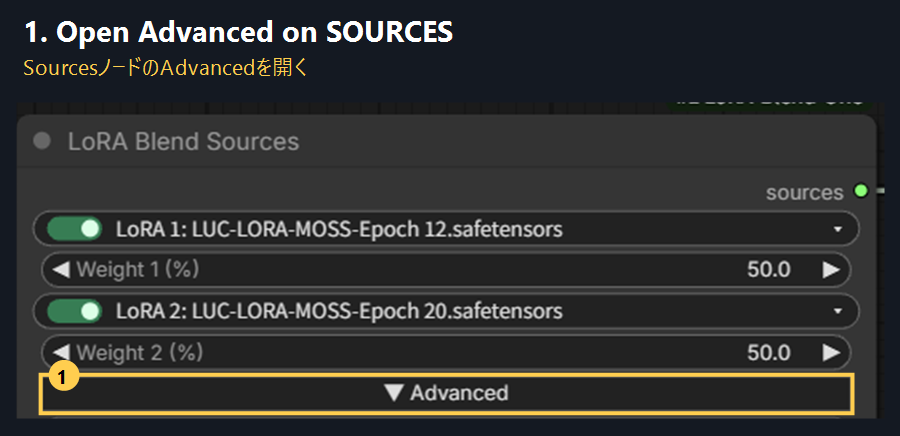
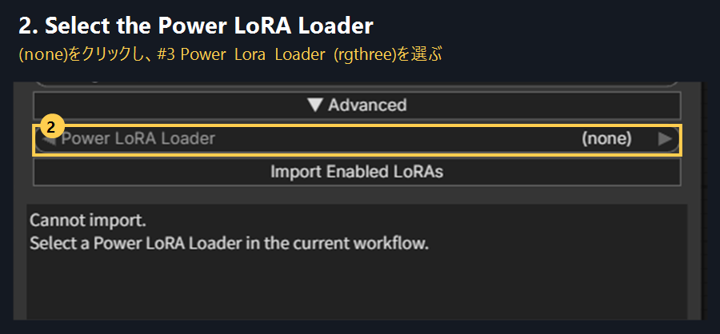
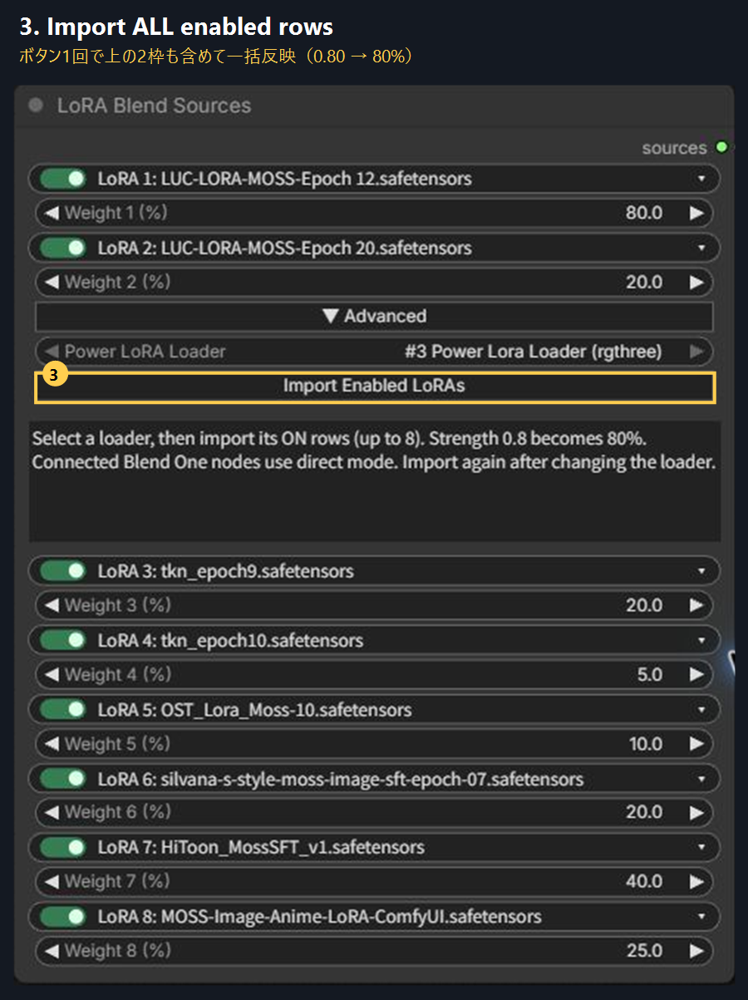
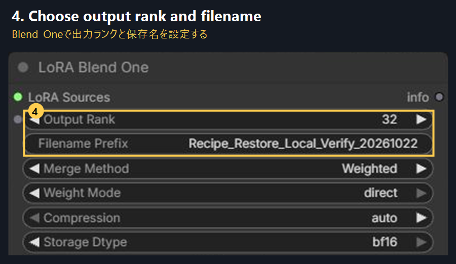
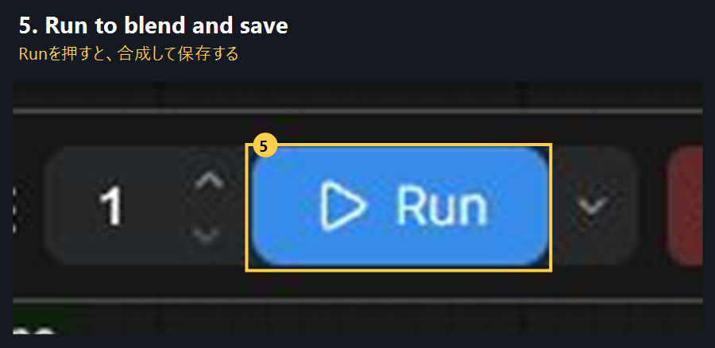
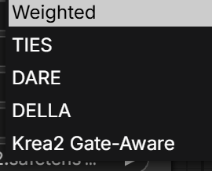

[English README](README.md)

# LoRA Blend One — 日本語ガイド

**v0.90 — Still Experimental Node**

本ノードは実験段階です。機能とモデル互換性の検証を進めています。



複数の互換LoRAをブレンドし、ComfyUIで再利用できる1つの `.safetensors` に保存するカスタムノードです。

[English README](README.md) · [検証状況](VALIDATION.md) · [変更履歴](CHANGELOG.md)

## 画面構成



左が **Power LoRA Loader (rgthree)**、中央が **LoRA Blend Sources**、右が **LoRA Blend One** です。**Sources → Blend One** を接続します。

Loaderの設定を取り込むには、**Sources → Advanced** で **Power LoRA Loader** を選択し、**Import Enabled LoRAs** を押します。Loader自体への配線は不要です。この画像は画面構成の例で、取り込み元はまだ `(none)` です。[画像付きの取り込み手順はこちら](#power-lora-loaderの設定を取り込む)。

## インストール

ComfyUIの `custom_nodes` 内で実行します。

```sh
git clone https://github.com/ukr8b3g-cmyk/LoRA-Blend-One.git ComfyUI-LoRA-Blend-One
```

ZIPの場合は `ComfyUI/custom_nodes/ComfyUI-LoRA-Blend-One/__init__.py` となるよう展開してください。ComfyUIを再起動し、ブラウザも再読み込みします。ComfyUI付属のtorch・safetensorsを使い、追加依存はありません。

## 基本操作

[LoRA Blend Oneテンプレート](example_workflows/LoRA_Blend_One.json)をComfyUIで開くか、ComfyUI再起動後に **ワークフロー → テンプレートを参照** から本パッケージを選びます。Sources → Blend One → Preview Anyを接続済みです。LoRAは自分のファイルを選択してください。出力ランク16、シード0・固定、詳細レポートオフで開始します。

1. `model/merging/LoRA Blend One` から **LoRA Blend Sources** と **LoRA Blend One** を追加します。
2. `sources` 同士を接続します。
3. 同じベースモデル向けのLoRAを選び、比率を指定します。
4. まずは合成方式 **Auto**、比率モード **normalize**、圧縮 **auto** で使用します。
5. 出力ランクと保存名を指定し、実行します。

既定では `ComfyUI/output/loras/LoRA_Blend_One_00001_.safetensors` などへ保存されます。生成に使う際は `ComfyUI/models/loras/` または設定済みのLoRAフォルダへコピーし、ファイル一覧を更新して通常のLoRAローダーで選んでください。

SourcesのAdvancedを開くとLoRA 3～8を指定できます。Seed（初期値0）や使用頻度の低い数値・診断項目もAdvancedにあります。2ノード構成の詳細JSONレポートは初期値オフです。旧ワークフロー向けに **LoRA Blend One (Legacy)** も維持しています。

各LoRAは「ファイル名」「比率（重み）」の2段表示で、ファイル名行の **ON/OFF** を切り替えられます。OFFにしてもファイル名と重みを保持し、その枠をファイル検証・読み込み・合成から除外します。既存ワークフローでは初期状態はONです。

停止時はノード上の赤いパネルに、対象LoRAの枠番号・ファイル名、停止理由、直し方を表示します。長い名前は折り返し、英語・日本語の表示に従います。設定・保存先のエラーや原因未特定の場合は、特定のLoRAを原因と断定しません。再実行時に前のエラーを解除し、成功するとモデル判定表示に戻ります。

## Power LoRA Loaderの設定を取り込む

**取り込み元はPower Lora Loader (rgthree)のみ対応しています。** 標準LoRA Loaderや、他のLoader／Stackノードは取り込み対象ではありません。

この機能は**設定の一括コピー**です。Power LoRA Loaderは**どこにも配線しなくて構いません**。MODEL・CLIPの入出力はすべて未接続で使えます。Sourcesと**同じワークフロー内**に配置してください。必要な配線は次の1本です。

```text
LoRA Blend Sources [sources] ───▶ [LoRA Sources] LoRA Blend One
```

### 1. SourcesのAdvancedを開く

**LoRA Blend Sources側**の **Advanced（詳細設定）** を開きます。取り込み操作は、このノード内にあります。以下は英語UIの実画面です。



### 2. 取り込み元を選ぶ

**Power LoRA Loader**と書かれた行の **(none)** をクリックし、例えば **#3 Power Lora Loader (rgthree)** を選びます。番号は自分のノードに合わせてください。**Cannot import / Select a Power LoRA Loader** と出る場合は、ここが未選択です。



### 3. 上の2枠も含め、ONのLoRAを取り込む

**Import Enabled LoRAs（ONのLoRA設定を取り込む）**を押します。**Advancedより上にあるLoRA 1・2も含めて、1番枠から一括で入ります。** 最初の2本を手入力する必要はありません。図では強度 `0.80／0.20` が `80／20%` になり、残りのONのLoRAが表示順に3～8番枠へ入っています。OFFの行は元のLoaderに残して除外し、Sourcesの未使用枠は空・OFFにします。



直接接続されているBlend Oneはすべて **direct** になり、元の強度を維持します。その他の合成設定と元のLoaderは保持します。**常時連動ではないので、元のLoaderを変更したら再度取り込んでください。**

### 4. 出力ランクと保存名を設定する

**LoRA Blend One**の **Output Rank（出力ランク）** と **Filename Prefix（保存名）** を設定します。図のランク32は例なので、自分の保存設定に変更してください。合成対象のファイルと強度は **Sources** にあります。



### 5. Runで保存する

**Run**を押すと合成して保存します。設定を取り込んだだけではファイルは作られません。保存したブレンドは、その後いつもの画像生成用LoRA Loaderで使用します。



**制限：** ONは最大8本です。ファイルの不足・同名候補の曖昧さ、不正な強度、取り込み先を上書きする入力接続がある場合は、値を変更する前に理由を表示します。CLIP入力が接続され、ModelとCLIPで異なる強度を使っている場合は、1つの合成係数で両方を再現できないため、同じ強度にするかCLIP入力を外してから取り込んでください。

**ローカル確認（2026-10-22）：** 既存Chromeタブで、全端子未接続・10行のPower LoRA LoaderからONの8本を `80／20／20／5／10／20／40／25%` で取り込みました。全ファイル名・強度・ON状態が保存JSONと一致し、タブを開き直しても保持されました。元の2ワークフローのJSONは変更前後で完全一致しています。実画面は英語、英日ラベル・エラーはVMテストで確認済みです。この取り込み確認では合成・画像生成は実行していません。

## 保存済みブレンドの確認・復元

**LoRA Blend Oneの詳細設定**で **保存済みブレンドLoRA** を選び、**レシピを確認・更新** を押します。対象ファイルは設定済みのLoRAフォルダーに置いてください。元LoRA名、合成係数、SHA256の照合結果、方式、ランク、保存精度、全体強度をノード内で確認できます。

**SourcesとBlend Oneに復元** を押すと、接続された **LoRA Blend Sources** と合成設定へ復元します。比率は `direct` の「係数×100」、使用枠はON、未使用枠は空・OFF、記録されたSeedは固定になります。保存名は維持します。旧レシピには元の入力数値・比率モードがないため、保存された合成係数を再現します。

元LoRAファイルが必要です。不足、ハッシュ不一致、同名ファイルを特定できない場合、設定値が対応範囲外の場合は、両ノードを書き換える前に復元を停止します。ハッシュの記録がない場合は名前のみの照合と明示します。同じレシピ形式ならMOSS以外にも使えます。圧縮後の重みから元LoRAを取り出す機能ではありません。更新後はComfyUIの再起動とブラウザーの再読み込みが必要です。

### ドラッグ＆ドロップ

LoRA Blend Oneで作った `.safetensors` をComfyUIのキャンバスへドロップすると、**新しいワークフロータブ**にSourcesとBlend Oneを配置・接続し、元LoRA名・合成係数・合成設定と固定Seedを復元します。既存タブは残ります。同じファイルを繰り返しドロップしても別タブになり、ブレンドは自動実行しません。

ドロップするブレンドLoRAはモデルフォルダー外でも構いません。ブラウザーでヘッダーだけを読み、レシピ情報だけをローカルComfyUIへ渡します。元LoRAはインストールが必要です。不足・同名候補の曖昧さ・ハッシュ不一致がある場合は、確認用タブを**全枠OFF**で開きます。ファイルの問題を解消して **レシピを確認・更新 → SourcesとBlend Oneに復元** を実行してください。取り込んだレシピはワークフロー保存後も残ります。通常の画像・ワークフロー・レシピのないLoRAは既存の読み込み処理に渡します。

## モデル差分から抽出する（MOSS-Image）

**model/merging/LoRA Blend One** カテゴリに、抽出用の2ノードを追加しています。

[モデル抽出用テンプレート](example_workflows/LoRA_Blend_Model_Extract.json)を読み込むか、ComfyUI再起動後に **Workflow → Browse Templates** から本パッケージを開いてください。**Inspect → Extract** を接続済みで、初期値は **Full Scan・固定ランク32・BF16・Seed 0／fixed・Review Only** です。両ノードのモデル選択用表示を、使用する元のMOSS-Imageモデルと変更後のモデルに置き換え、Runで保存せず分析できます。Base Modelは比較元のモデルを意味し、SFTモデルも指定できます。分析完了後に **Apply Recommendations** を押すと推奨値を一度だけ反映し、その後も手動調整できます。保存するときは **Extract and Save** を選んでからRunを押します。ボタンを切り替えただけでは抽出を開始しません。

- **LoRA Blend Model Inspect：** 元モデルと変更モデルを比較します。Header検査は対応キーと形状を照合し、**Full Scan**では値を読み込んで変更パラメーターも確認します。
- **LoRA Blend Model Extract：** `変更モデル − 元モデル` を **Fixed Rank／Auto Rank／Full Delta** で保存します。登録済みの2モデル、方式、保存精度、出力名を選択します。ランク上限・SVD方式・計算デバイス・非LoRA差分の扱いは **Advanced** 内です。

抽出の対応は、現在 **単体・非量子化のMOSS-ImageネイティブSafetensors** に限ります。他モデル・分割シャード・量子化入力は有効化していません。LoRA合成とは別の処理であり、下記の合成用モデル互換表は抽出には適用されません。

非LoRA差分の初期設定 **Stop** は、対応するA/B因子で表現できない変更があると停止します。**Store Diff** はComfyUIの `.diff` テンソルとして保持した **hybrid_delta**、**Exclude With Report** は除外内容を記録した部分抽出になります。Hybrid／Full DeltaはComfyUI拡張形式で、**現在のBlend One Sourcesには入力できません**。元の学習LoRAの復元や、小容量化を保証する機能ではありません。保存先は `ComfyUI/output` 内です。通常のLoRA Loaderで使う場合は、設定済みのLoRAフォルダーへ保存ファイルを配置してください。

### ランク・推奨値の適用・保存

新しいExtractの初期値は **固定ランク32** です。**Rank Preset** から16／32／64／128／256を選択でき、Rank欄は17や24を含む1〜4096の整数を指定できます（各行列の寸法も上限です）。Auto Rankも選択でき、Maximum Rankの初期値64は手動で増やせます。固定ランクでは保持率99％を目標にしません。既存ワークフローの保存値は維持します。

Inspectは分析結果と推奨値を読みやすく表示し、**extraction_plan** 出力でExtractに接続できます。接続中もExtractの設定を編集でき、接続・再分析・ワークフロー再読込による自動上書きはありません。**Apply Recommendations** を押したときだけ、完了したFull Scanのモデルペアと推奨値を一度コピーし、出力名は維持します。適用後もランク・保存精度などを手動調整できます。Full Scanは必要ランクや出力容量を測定しないため、32は実用的な開始値であり、精度の保証ではありません。接続時にモデルペアが異なる場合や分析後にファイルが更新された場合は、再分析が必要です。

横並びの **Review Only／Extract and Save** ボタンは、選択中をチェックマークと黄色／緑色で強調し、次の **Run** で行う内容を下に表示します。ボタンを切り替えただけでは実行しません。Review Onlyは現在の手動値と推奨値を分けて表示し、保存しません。Inspect未接続ならExtractの手動設定で直接抽出できます。Extract／Inspectの項目名は英語で、マウスオーバーのヘルプと結果説明は英語・日本語のロケールに追従します。

抽出結果の保存用テンソルが累計 **256 MiB以下** ならCPUメモリに保持し、一度に書き込みます。超えた場合はディスクの分割保存に切り替えます。この上限は保持テンソルの容量で、処理全体のRAM上限ではありません。非有限値検査・保存後の全テンソル照合・中断処理・既存ファイルの非上書きは継続します。SVDや重み誤差の計算は変更していません。

### 抽出操作のローカル検証（2026-10-23〜24）

**Python 88件・JavaScript 37件が成功**しました。Inspect接続中の手動値、英日ヘルプ、ボタン選択・保存値の順序、メモリ／ディスク保存、保存データ改変の検出、既存MOSS／Krea2ブレンドの回帰確認を含みます。JavaScriptはテスト用Graph／DOMによる確認です。

比較対象を修正した **通常MOSS SFT BF16 → KR2 SFT BF16**（マージモデルのMoss_Lucではありません）を、固定ランク32・BF16・Seed 0・全対象・Stop・入力ハッシュON・CPU 4スレッドで確認しました。

| 確認内容 | 結果 |
| --- | --- |
| Full Scan | 462項目一致、168行列が変更、行列以外の変更0、24.26秒 |
| 接続したReview Only | 推奨ランク32と別に手動ランク17／FP32を維持、保存なし |
| 通常LoRAの保存 | 168対象すべてランク32、101,914,936 bytes／101.91 MB／97.19 MiB |
| 重みの再構成 | 相対誤差96.5484％、差分エネルギー保持率6.7841％。画像品質の点数ではありません |
| ComfyUI標準ローダー | 168対象を認識、未使用キー0、実モデルのQスライスへの適用が期待値と一致 |
| 抽出から保存まで | CPUで299.99秒。GPU・全工程の速度比較ではありません |
| 同じテンソルの保存単体比較 | 3.21695秒 → 0.34744秒、分割ファイル168個 → 0個、全テンソル一致 |

保存単体比較は同一ディスク上で旧→新を各1回測った値で、キャッシュの影響を含みます。抽出全体の高速化率やKJとの比較を示すものではありません。ランク32は容量重視で、このモデル差分を忠実に再現する設定ではありません。抽出テンプレートのJSON・入力仕様・接続・初期値、小型CPUデータでのInspect→Extract（Review Onlyで保存なし）を確認しました。起動中ComfyUIのテンプレート一覧APIとテンプレート取得も成功しています。**今回の抽出ボタン・テンプレートのChrome実画面、GPU画像生成、画質比較は未実施**です。更新後はComfyUIを再起動し、ブラウザーを再読み込みしてください。詳細は [VALIDATION.md](VALIDATION.md) を参照してください。

### 以前のマージモデル抽出結果（2026-10-23）

同じローカルモデル `moss_image_sft_bf16.safetensors` → `Moss_Luc-sft-bf16.safetensors` を、CPU・BF16保存・Seed 0・全対象・**Store Diff** で検証しました。各試行で入力SHA256の一致も確認しています。

| 抽出条件 | 相対重み誤差 | 実測の全体保持率 | 出力容量（10進） |
| --- | ---: | ---: | ---: |
| 固定ランク16・自動SVD | 95.0658％ | 9.6249％ | 80,053,060 bytes／80.05 MB |
| 自動ランク・99％目標・上限256・自動SVD | 83.8158％ | 29.7491％ | 1,268,436,340 bytes／1.2684 GB |
| 自動ランク・99％目標・上限3072・**厳密SVD** | **9.9223％** | **99.0155％** | **11,108,963,604 bytes／11.1090 GB（10.3460 GiB）** |

厳密SVDでは、**269行列の採用ランクは125〜2898、中央値1823** で、上限3072に達した層はありませんでした。保存精度への変換前は全行列で99％を達成しています。ただし、**BF16丸め後は49行列がわずかに未達となり、最低98.99945％** でした。保存後の**全体では99％達成**ですが、**全層が厳密に99％以上という保証ではありません**。最大採用ランクはこのモデルペアと厳密SVDでの結果であり、一般的な推奨ランクではありません。上限256の試行は大型行列で近似SVDを使用しているため、上限だけでなく分解方式も変わっています。

保持率は `1 − 相対Frobenius誤差²` で、**モデル重み差分の再構成精度**です。画像の一致率や画質ではありません。エネルギー保持率99％は、相対ノルム誤差では約10％に相当します。出力は元モデル約10.16 GBより大きく、このペアの高保持率抽出では小型化の利点は得られませんでした。厳密SVDのCPU試行は保存検証を含め約35.5分で、この1回の実測値です。

3出力とも保存・再読込に成功し、ComfyUI標準MOSSローダーで **344変更対象（269行列＋直接差分75対象）を認識、未使用キー0件** を確認しました。Qスライス・O投影・norm1への実適用も成功しています。別途、1層だけを明示選択した部分的な標準LoRAではBlend Oneでの合成・保存・再読込も通過しましたが、全体のhybrid出力が合成入力に対応するという意味ではありません。抽出ノードの実画面、GPU画像生成、画質比較は未実施です。詳細は [VALIDATION.md](VALIDATION.md) と [実装設計・対応範囲](docs/MODEL_DELTA_EXTRACT_DESIGN.ja.md) を参照してください。

## 複数キューの進捗・エラー表示（2026-10-28）

Model Extractの進捗・結果と、Legacy／Split／Sourcesのエラー表示で、**各ジョブの受付応答に含まれるprompt ID**を使う小さな共通処理を利用します。複数件を先にQueueしても、2件目の表示が更新されなくなったり、前のエラーのLoRA名が残ったりしないよう修正しました。別の実行・古い通知を除外し、受付応答より先に届いた結果も保持します。応答順が逆になっても新しい表示を古い結果で上書きしません。完了・中断・キューが空になった際の取消分・ノード削除で実行記録を解放します。

**検証結果：JavaScript 51件成功。** エラー表示と既報の抽出進捗を再現したケースを含みます。ComfyUI_testへ配置後、隔離Chromeの実フロントエンドにテスト用の受付応答・通知を送り、2件目の進捗と原因LoRA名、同じ番号の別ノードへの混入防止、保存設定値と順序の保持を確認しました。この画面試験の抽出通知は模擬であり、実モデル抽出やGPU画質の検証ではありません。合成・抽出計算、保存処理、対応モデル、接続端子は変更していません。**更新後はブラウザーを再読み込みしてください。今回の修正には本体の再起動は不要です。** 詳細は [VALIDATION.md](VALIDATION.md) を参照してください。

## 重み0と抽出進捗の修正（2026-10-24）

**Auto／Weighted／TIES／DARE／DELLA** では、同じファイル名の係数を合算し、実効重みが厳密に0になった入力を、**ファイルの読み込み・モデル互換性判定より前に除外**します。MOSSの合成にSDXL用LoRAが0％で残っていても停止せず、Sourcesの入力検証も0％の存在しないファイルを無視します。選択欄・トグルは編集可能な状態で保持し、保存レシピには寄与する入力だけを記録します。全重み0では従来どおり重みエラーで停止します。**Krea2 Gate-Awareは0係数を含む2入力の扱いを維持**します。

**Model Extractの進捗**は、元の実行ID・ワークフロー・ノードに関連付けます。送信先クライアントを実行開始時に保持し、受信ノードも実行情報と所属グラフを照合します。同じノード番号がある別ワークフローへタブを切り替えても、そのワークフローの表示を上書きしません。ノード削除時には進捗イベントの購読を解除します。

**検証結果：** 修正前に両方の問題を再現し、修正後は **Python 89件・JavaScript 38件が成功**しました。CPUのノード試験で通常5方式、保存・再読込とレシピ、0％の別系統／存在しないファイル、同名入力の係数相殺、全0の拒否、Krea2の既存動作を確認しました。JavaScriptのGraph／DOM試験では、同じ番号の別ワークフローノード、古い／別の実行、異なるワークフロー・ノード、実行ID欠落、グラフ変更、購読解除、日本語の停止表示を確認しています。バックエンド試験では、実行中にサーバー側の現在クライアントが変わっても、元のクライアントだけへ進捗が届くことを確認しました。SVD・抽出計算・保存精度は変更していません。

これらはCPUとテスト用フロントエンドによる確認です。**今回の修正について、実ブラウザーのタブ切替・GPU生成は未実施です。更新後はComfyUIを再起動し、ブラウザーを再読み込みしてください。** 詳細は [VALIDATION.md](VALIDATION.md) を参照してください。

## UIの言語

基本表示は英語です。ComfyUIの **設定** で **言語（Language）**（`Comfy.Locale`）を検索し、**日本語** にすると、項目名・ツールチップ・詳細設定ボタン・モデル判定表示が日本語になります。英語に戻すと英語表示になります。AutoやKrea2 Gate-Awareなどの方式名は共通です。

## 対応範囲とランク

| モデル | 処理 |
| --- | --- |
| MOSS-Image Base／SFT | 自動識別・キー名とQKV形式の統一 |
| Krea2 | 専用Gate-Aware方式と通常方式 |
| FLUX／Qwen Image／Wan／SD系など | 標準LoRAの共通処理。モデル別のキー変換はありません |

同じベースモデル向けで、適用先の層の名前と入出力サイズが互換な標準LoRAを使用します。**入力ランクは同じでなくて構いません。** ランク128＋32を合成して、出力ランク16で保存することもできます。

DoRA・LoHa・LoKr・LoCon-mid・モデル全体の差分などは、**ブレンド入力としては**対応範囲外です。MOSSでは未対応テンソル、欠けた因子ペア、曖昧な別名の重複も検出して停止します。各モデルの実画像生成・画質比較を網羅検証したものではありません。

## MOSS-Imageの使い方と表示

MOSS用LoRAを選び、合成方式を **Auto／Weighted** などに設定してください。**MOSS-Imageは合成方式の一覧に追加される項目ではなく、自動識別されます。**

正常に実行が完了すると、ノード下部に緑色で **「前回のモデル判定：MOSS-Image」** と表示します。未実行時は「モデル判定：実行後に表示」です。この表示は前回成功した実行結果を示します。

QKV結合・分割形式とキー名の違いを合成前に揃え、alpha／rankの倍率を維持します。出力はComfyUI用の分割Q／K／V形式です。高速化パッケージの専用サンプラーや時間埋め込みファイルまでは、LoRAへ統合しません。

## 比率モード

- **direct**：入力値を100で割り、そのまま強度として使います。`80／40／20`なら`0.8／0.4／0.2`で、合計は**1.4**です。
- **normalize**：比率を保ち、合計が**1.0**になるようにそろえます。同じ入力なら約`0.571／0.286／0.143`です。

`80／20`のように入力合計が100なら両者は同じです。上の8本の例は合計220なので、normalizeにすると先頭LoRAの強度は`0.8`から約`0.364`へ変わります。**Power LoRA Loaderの元の強度を引き継ぐため、取り込み時にはdirectへ設定します。** 合成方式とは別の設定です。

| 入力 | normalize | direct |
| --- | --- | --- |
| 30／70 | 0.3／0.7 | 0.3／0.7 |
| 80／40／20 | 約0.571／0.286／0.143 | 0.8／0.4／0.2 |

既存の複数LoRAローダーで使っている強度を引き継ぐ場合は **direct** を選びます。directでは負の係数も使用できます。Krea2 Gate-Awareは比率モードにかかわらず直接係数を使います。係数はモデル差分の強さであり、見た目の混合割合を保証する数値ではありません。

## 出力ランク・精度・サイズ

数値で指定した出力ランクは、保存する各層・各投影の上限になります。ランクを下げると通常はサイズが減り、表現の一部が失われる可能性があります。

- **auto**：出力ランクAutoならエネルギー基準、数値指定なら固定ランク圧縮。
- **energy**：エネルギー基準で選び、数値ランクを上限として使用。
- **fixed_rank**：数値ランクの指定が必要。
- **max_input_rank**：入力最大ランクを使い、数値ランク指定があればさらに制限。
- **none**：Weighted専用。Autoまたは結合ランク以上の指定なら厳密結合、低いランクを指定するとSVD圧縮。

Energy Targetは数値上の差分エネルギーで、画質の保持率ではありません。TIES／DARE／DELLAの自動エネルギー選択にはAdvancedの `auto_rank_cap` も適用されます。

**保存dtypeがAutoの場合、全入力で共通の精度を維持し、異なる精度が混在するとFP32で保存します。** FP32とBF16を混ぜてサイズが大きくなる場合は、保存dtypeを明示してください。計算精度はFP32です。

## 合成方式



**この実装ではAutoはWeightedです。** MOSSの通常のブレンドはここから始められます。他の方式は比較して試す選択肢で、画質が必ず良くなるわけではありません。

| 方式 | このノードでの処理 |
| --- | --- |
| **Weighted** | 各LoRAの差分を、指定した強度で足し合わせます。基本の方式です。 |
| **TIES** | 小さい差分を間引き、初期設定では差分の向きが衝突する部分を整理します。詳細設定：density、符号合意。 |
| **DARE** | 差分をランダムに間引き、残した部分の強度を補正します。詳細設定：density、Seed。符号合意の初期値はオフです。 |
| **DELLA** | 大きい差分ほど残りやすい確率で間引き、強度を補正します。符号合意の初期値はオンです。詳細設定：density、half width、Seed。 |
| **Krea2 Gate-Aware** | ONのKrea2用LoRA **2本専用**。ゲート層の競合を調整します。MOSSには使えません。 |

### 処理時間について

| 方式 | 出力圧縮前に行う処理 |
| --- | --- |
| Auto／Weighted | 低ランクの因子で計算し、この実装では通常もっとも軽い経路です。 |
| TIES | 元の大きさの差分行列を作り、値の大きさによる選別・符号合意を行ってから再分解します。 |
| DARE | 元の大きさの差分行列を作り、乱数による間引き・強度補正を行ってから再分解します。 |
| DELLA | さらに値の大きさを並べ替え、残す確率を計算します。初期値では符号合意も行うため、特に重くなる場合があります。 |

TIES・DARE・DELLAはいずれもWeightedより時間・メモリを必要とする場合があります。大きなLoRAを多数合成する場合やCPU計算では特に影響します。現在の符号合意処理では、元LoRAごとの間引き済み差分を2回計算します。方式間の速度順位や所要時間は環境・設定により変わります。**出力ランクを下げても、その前段の差分行列作成・選別・並べ替えは省かれません。** ランクは主に保存時の圧縮設定です。Seedは乱数の再現用で、高速化の設定ではありません。

## 確認済みの範囲

### 入力・保存の安全性（2026-10-23）

- **NaN／Inf対策：** 入力因子、alpha／実効合成係数、保存精度への変換後を検査します。不正な出力は最終ファイルの置換前に停止し、対象ファイル・層と英日対処方法を示します。積が小さくても、有限なFP32因子がFP16変換であふれる場合があります。その場合は強度を確認するかFP32／BF16を選んでください。保存精度は自動変更しません。
- **未対応テンソル：** 汎用形式でも全テンソルキーを照合します。追加bias・OFT・正規化・不完全な因子などは黙って除外せず、ファイル名・キー名を示して合成を停止します。MOSSの既存の厳密検査と、既知の未対応形式を拒否する経路は維持しています。
- **任意レポートの失敗：** 本体が保存済みなら保存成功とし、ノード出力に本体の保存先と警告の詳細を返します。レポートは一時ファイル経由で保存し、書込み失敗時に既存レポートを切り詰めません。レポートOFFの動作は維持します。

3系統とも修正前に再現しました。今回の公開対象だけを取り出した環境で **Python 56件**（**追加の安全性テスト14件**、既存MOSS **8件**・Krea2 **6件**を含む）、**JavaScript 19件**が成功しました。有限なFP16／BF16／FP32の保存・再読込、不正値・保存変換時のあふれ・未対応キーの拒否、レポートI/O障害時の本体保存成功とノード出力を確認しています。CPU試験は一時ファイルとComfyUI代替サービス、JavaScriptはテスト用Graph／DOMを使用しました。今回の修正について、実ブラウザー・実LoRAのGPU生成・CUDA OOM復帰・画質比較は再実施していません。下記の過去の実機確認とは区別してください。更新したPythonの反映にはComfyUIの再起動が必要です。

Python 65件とJavaScript UI 34件の自動テストが成功しています。MOSS形式の互換性、通常方式／Krea2、ランク制限、ノード統合、言語切替、各LoRAのON/OFF、ワークフローの保存・復元を含みます。エラーの原因ファイル、別フォルダーの同名LoRA、メモリ不足・保存失敗・中断の扱いも確認しています。英語・日本語のエラーパネル描画とイベント処理はJavaScript VMで確認済みです。既存のChromeタブ内で元ワークフローを複製し、MOSS-Image用LoRA 5本にSDXL用LoRAを7番枠でONにして実際に互換性エラーを発生させました。ComfyUIの再起動とブラウザーの再読み込み後、ノード上に正しい枠番号・ファイル名、日本語の停止理由・対処方法が表示されることを確認しました。元ワークフローの設定・配線は保持しています。更新後はブラウザーも再読み込みして新しいエラーUIを反映してください。

手元のMOSS用LoRA（ランク128／32／32）を強度0.8／0.4／0.2で全252層ブレンドし、保存・再読込とComfyUIローダーでの全層解析、Q／O層の重み適用をCPUで確認しました。FP32保存時はランク16で約149MB、ランク32で約297MBでした。

### MOSS-Image SFT：実ブレンド・保存・読み込み・GPU画像生成

**2026-10-22**、起動中のComfyUIと既に開いていたChromeタブで、一連の操作が成功しました。

| 段階 | 確認結果 |
| --- | --- |
| 入力 | `LUC-LORA-MOSS-Epoch 12.safetensors` ＋ `LUC-LORA-MOSS-Epoch 20.safetensors`、50:50、`normalize` |
| ブレンド | Auto → Weighted、CPU計算、出力ランク16、BF16保存、シード0・固定 |
| 保存ファイル | **72,633,952 bytes（約72.6 MB）**、246レイヤー、全層ランク16、ブレンド警告0件 |
| 再読み込み | 全**738テンソル**が有限値で、ComfyUIパーサーがすべて認識。未使用テンソル・形状不一致0件 |
| 生成時の適用 | 保存したブレンドを **Power Lora Loader (rgthree)** で強度**0.3**に設定し、`moss_image_sft_bf16.safetensors` に適用 |
| 生成画像 | **896×1184**、8 steps、CFG 1、`er_sde`／`simple`、固定シード525173493099460。WEBP保存・目視確認まで成功 |

検証環境（RTX 5060 Ti、VRAM 16 GB）でのジョブ実行時間は、ブレンド3.774秒、画像生成19.079秒でした。この1回の実測値であり、一般的な所要時間の目安ではありません。実行履歴でも保存済みブレンドが強度0.3で有効だったことを確認し、出力画像を正しい寸法で読み込めました。黒画像やノイズだけの出力にはなっていません。

生成時は元ワークフローの他のLoRAも併用しています。この条件での読み込み・生成の確認であり、ブレンド単独の画質A/B比較や、すべてのMOSS用LoRA・MOSS-Image Base・他モデルの動作保証ではありません。

Chrome実画面ではテンプレート読み込み、Advancedの開閉、英語→日本語→英語の切替、保存後に閉じて開き直す操作も確認しました。Custom Rank 48、Energy Target 0.975、保存dtype BF16を維持し、API出力44項目も保存値・宣言された入力型と一致しました。

### ON/OFF：Chrome実動確認

**2026-10-22**、ComfyUI再起動後、既に開いていたChromeタブで現在のワークフローを複製して確認しました。各LoRAの「ファイル名」「比率（重み）」の2段を維持し、ファイル名行のスイッチで操作できました。LoRA 5のファイル名 `silvana-s-style-moss-image-sft-epoch-07.safetensors` と重み **20** は、切替の前後で保持されました。

| LoRA 5のスイッチ | 保存結果 |
| --- | --- |
| OFF | 4本を合成し、保存recipeからLoRA 5を除外 |
| ONに戻す | 5本を合成し、保存recipeにLoRA 5が復帰 |

両方ともMOSS-Image用LoRAとして保存に成功し、**246レイヤー・全層ランク32・全738テンソル有限値・ブレンド警告0件**を確認しました。元ワークフローは保持し、確認後にChromeの表示を元へ戻しました。この確認の範囲はスイッチ・合成・保存で、画像生成の確認結果は上節に記載しています。

詳細な形式・検証方法は [English README](README.md) と [VALIDATION.md](VALIDATION.md) を参照してください。

## ライセンス

[MIT](LICENSE)。モデルやLoRAファイルには、それぞれのライセンスが適用されます。
